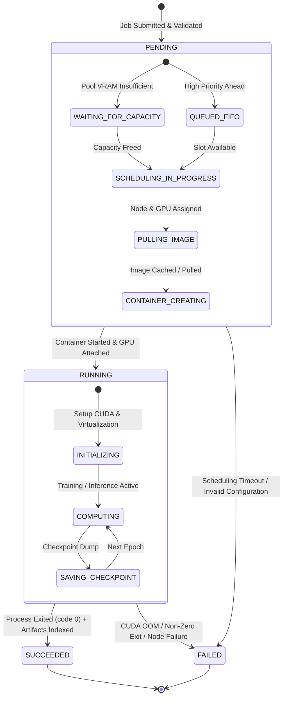

# CGPU Job API Specification

- **Document Version**: `1.0.0`
- **Status**: `Approved / Draft for Review`
- **Issue**: [#8 — Issue B1: Define the job API and prepare mock responses](https://github.com/Deeppatel40/CGPU-Cloud-GPU-Resource-Pooling-and-Virtualization-Platform/issues/8)
- **Owners**:
  - Nirav Shah ([@NiravShah1729](https://github.com/NiravShah1729)) — API Design & Go Backend
  - Subrat Jain ([@subrat-j](https://github.com/subrat-j)) — Next.js Portal Integration & UI Contract
- **Collaborators**:
  - Deep Patel ([@Deeppatel40](https://github.com/Deeppatel40)) — Placement Engine & Virtualization Layer
  - Nishit ([@Nishit1006](https://github.com/Nishit1006)) — Kubernetes Infrastructure & Node Management

---

## 1. Overview & Architecture Context

The CGPU platform enables multi-tenant GPU sharing and virtualization across heterogeneous computing nodes (such as our RTX 4050 6GB WSL worker node from Issue #16). 

This document defines the interface boundary and protocol contract connecting:
1. **Next.js Web Portal** (Client UI)
2. **Go REST API Gateway & Job Manager** (Backend Coordinator)
3. **CGPU Scheduler & Placement Component** (K8s / Virtualization Engine)

```text
┌───────────────────────┐
│ Next.js Web Portal    │
│ (Frontend Dashboard)  │
└───────────┬───────────┘
            │ HTTP / JSON (REST + SSE)
            ▼
┌────────────────────────────────────────────────────────┐
│ CGPU Go API Gateway & Job Manager                      │
│ - Request Idempotency & Validation (request_id)        │
│ - Job Lifecycle State Machine (MongoDB Persistence)    │
│ - Telemetry Aggregator & Artifact Handler              │
└───────────┬────────────────────────────────────────────┘
            │ Internal Go Channel / RPC Contract
            ▼
┌────────────────────────────────────────────────────────┐
│ CGPU Scheduler & Placement Engine (Deep & Nishit)      │
│ - Evaluates GPU Inventory & VRAM Quotas                │
│ - Assigns (Node, GPU ID, VRAM Quota MiB)               │
│ - Dispatches to K8s Pod / CGPU Virtualization Driver   │
└────────────────────────────────────────────────────────┘
```

---

## 2. Approved Demonstration Workload

To benchmark and demonstrate GPU virtualization, pooling, and fractional memory scheduling on our RTX 4050 6GB (6,144 MiB) WSL worker node, the approved demonstration workload is:

### **PyTorch ResNet-18 Image Classification (`pytorch-resnet18-cifar10`)**

- **Image Repository**: `cgpu/workloads/pytorch-resnet18-cifar10:1.0.0`
- **Framework**: PyTorch 2.4+ with CUDA 12.4
- **Base Memory Footprint**: ~1,200 MiB (weights + activations)
- **Requested VRAM**: **`2048` MiB** (Default positive integer in MiB)
  - *Slicing benefit*: On a 6,144 MiB RTX 4050, up to **2 or 3 instances** can run concurrently under CGPU's fractional virtualization layer, proving multi-tenancy.

### Workload Interface Contract

#### Inputs
Workloads receive parameters via environment variable `CGPU_JOB_PARAMS` (JSON string) and a mounted configuration file at `/etc/cgpu/params.json`:
```json
{
  "epochs": 5,
  "batch_size": 64,
  "learning_rate": 0.001,
  "optimizer": "adam",
  "dataset": {
    "type": "builtin",
    "name": "cifar10"
  },
  "save_every_epochs": 1,
  "seed": 42
}
```

#### Outputs
1. **Standard Streams**:
   - `stdout`: Epoch milestones, loss, step throughput (images/sec), validation accuracy.
   - `stderr`: Non-fatal warnings and runtime exceptions.
2. **Execution Metrics (`/outputs/metrics.json`)**:
   - Final loss, validation accuracy, duration, peak VRAM utilized.
3. **Checkpoints (`/outputs/checkpoints/`)**:
   - Periodic checkpoints: `checkpoint_epoch_{N}.pt`
   - Final model weights: `model_final.pt`
   - All checkpoint files are discovered by the CGPU job agent and indexed for download via the Artifacts API.

---

## 3. End-to-End Submission & Retry Flow (Idempotency)

Network instability and user double-clicks must not result in duplicate GPU allocations.

```text
Client (Next.js)                  Go API Gateway               MongoDB / Scheduler
      │                                 │                              │
      │ 1. POST /api/v1/jobs            │                              │
      │    request_id: "req-7b3f9408"   │                              │
      ├────────────────────────────────►│                              │
      │                                 │ 2. Find by request_id        │
      │                                 ├─────────────────────────────►│
      │                                 │    (Not found -> Insert)     │
      │                                 │ 3. Submit to Scheduler       │
      │                                 ├─────────────────────────────►│
      │ 4. 201 Created                  │                              │
      │◄────────────────────────────────┤                              │
      │                                 │                              │
  [Network Timeout or Retry]            │                              │
      │                                 │                              │
      │ 5. POST /api/v1/jobs (Retry)    │                              │
      │    request_id: "req-7b3f9408"   │                              │
      ├────────────────────────────────►│                              │
      │                                 │ 6. Find by request_id        │
      │                                 ├─────────────────────────────►│
      │                                 │    (Found existing Job!)     │
      │ 7. 200 OK (Existing Job)        │                              │
      │◄────────────────────────────────┤                              │
```

### Idempotency Contract
- Header: `X-Request-Id: <UUIDv4>` or payload field `request_id: "<UUIDv4>"`
- The API enforces a uniqueness constraint on `request_id`.
- If a submission arrives with a previously seen `request_id`:
  - **No new job is queued or scheduled.**
  - The API responds with `200 OK` (instead of `201 Created`) returning the existing job metadata.

---

## 4. Status Lifecycle & State Machine



### State Definitions
| State | Description | Typical Sub-reasons |
| :--- | :--- | :--- |
| `PENDING` | Job admitted into system, waiting for GPU resource allocation or container bootstrapping. | `WAITING_FOR_CAPACITY`, `QUEUED_FIFO`, `SCHEDULING_IN_PROGRESS`, `PULLING_IMAGE`, `CONTAINER_CREATING` |
| `RUNNING` | Container active on assigned worker node with GPU slice mapped. | `INITIALIZING`, `COMPUTING`, `SAVING_CHECKPOINT` |
| `SUCCEEDED` | Workload exited successfully (exit code `0`) with outputs archived. | `COMPLETED_SUCCESSFULLY` |
| `FAILED` | Workload execution failed or was aborted. | `CUDA_OUT_OF_MEMORY`, `CONTAINER_NON_ZERO_EXIT`, `SCHEDULING_TIMEOUT`, `INVALID_WORKLOAD_PARAMS`, `DATASET_DOWNLOAD_FAILED`, `NODE_FAILURE`, `CANCELLED_BY_USER` |

---

## 5. API Endpoints Specification

### 5.1 Submit Job
- **`POST /api/v1/jobs`**
- **Headers**:
  - `Content-Type: application/json`
  - `X-Request-Id: <UUIDv4>` (optional if present in body)
- **Request Body**:
```json
{
  "request_id": "req-7b3f9408-e4b2-4d56-b072-20c2420a8511",
  "name": "resnet18-cifar10-run-1",
  "workload_id": "pytorch-resnet18-cifar10",
  "requested_vram_mib": 2048,
  "parameters": {
    "epochs": 5,
    "batch_size": 64,
    "learning_rate": 0.001,
    "optimizer": "adam"
  },
  "dataset": {
    "type": "builtin",
    "name": "cifar10",
    "uri": "builtin://cifar10"
  },
  "priority": 5,
  "timeout_seconds": 3600
}
```
- **Field Constraints**:
  - `request_id`: Required string, UUIDv4 format.
  - `name`: Required string, 1-64 alphanumeric characters, dashes, and underscores.
  - `workload_id`: Required string, matching registered catalog.
  - `requested_vram_mib`: Required positive integer `> 0` (e.g. `2048`). Values `<= 0` return `400 Bad Request`.
  - `priority`: Optional integer between `1` (lowest) and `10` (highest); default `5`.
  - `timeout_seconds`: Optional positive integer; default `3600`.
- **Responses**:
  - `201 Created`: Job accepted and queued.
  - `200 OK`: Idempotent return of existing job matching `request_id`.
  - `400 Bad Request`: Validation failure.
  - `409 Conflict`: Resource quota or state conflict.

---

### 5.2 Get Job Status & Details
- **`GET /api/v1/jobs/{job_id}`**
- **Response `200 OK`**:
```json
{
  "job_id": "job-9e2b14f8-45a1-432c-b58a-6b5832a8e412",
  "request_id": "req-7b3f9408-e4b2-4d56-b072-20c2420a8511",
  "name": "resnet18-cifar10-run-1",
  "workload_id": "pytorch-resnet18-cifar10",
  "status": "RUNNING",
  "sub_status": "COMPUTING",
  "requested_vram_mib": 2048,
  "placement": {
    "node_id": "wsl-worker-rtx4050-01",
    "gpu_id": "gpu-nv-rtx4050-c89b3f",
    "allocated_vram_mib": 2048,
    "enforcement_mode": "CGPU_VIRTUAL_CGROUP",
    "scheduled_at": "2026-11-14T11:20:00Z"
  },
  "telemetry": {
    "status": "AVAILABLE",
    "gpu_utilization_pct": 84,
    "memory_used_mib": 1780,
    "temperature_celsius": 68,
    "power_watts": 48.5,
    "sampled_at": "2026-11-14T11:21:45Z"
  },
  "timestamps": {
    "submitted_at": "2026-11-14T11:19:50Z",
    "scheduled_at": "2026-11-14T11:20:00Z",
    "started_at": "2026-11-14T11:20:15Z",
    "completed_at": null
  }
}
```

---

### 5.3 List Job History
- **`GET /api/v1/jobs`**
- **Query Parameters**:
  - `status`: Filter by state (`PENDING`, `RUNNING`, `SUCCEEDED`, `FAILED`)
  - `workload_id`: Filter by workload catalog ID
  - `page`: Page index (1-based, default `1`)
  - `limit`: Page size (default `20`, max `100`)
- **Response `200 OK`**:
```json
{
  "items": [
    {
      "job_id": "job-9e2b14f8-45a1-432c-b58a-6b5832a8e412",
      "name": "resnet18-cifar10-run-1",
      "workload_id": "pytorch-resnet18-cifar10",
      "status": "SUCCEEDED",
      "requested_vram_mib": 2048,
      "node_id": "wsl-worker-rtx4050-01",
      "submitted_at": "2026-11-14T11:00:00Z",
      "duration_seconds": 184
    }
  ],
  "pagination": {
    "current_page": 1,
    "page_size": 20,
    "total_items": 42,
    "total_pages": 3
  }
}
```

---

### 5.4 Fetch Job Logs
- **`GET /api/v1/jobs/{job_id}/logs`**
- **Query Parameters**:
  - `tail`: Number of lines to return from end (e.g. `100`)
  - `stream`: `true` for Server-Sent Events (SSE) live tailing
- **Response `200 OK` (Standard JSON)**:
```json
{
  "job_id": "job-9e2b14f8-45a1-432c-b58a-6b5832a8e412",
  "lines": [
    { "timestamp": "2026-11-14T11:20:16Z", "stream": "stdout", "message": "[CGPU] Initializing GPU virtual slice (2048 MiB allocated)" },
    { "timestamp": "2026-11-14T11:20:20Z", "stream": "stdout", "message": "Epoch [1/5], Step [100/782], Loss: 1.8421, Acc: 42.1%" }
  ]
}
```

---

### 5.5 List & Download Artifacts
- **`GET /api/v1/jobs/{job_id}/artifacts`**
- **Response `200 OK`**:
```json
{
  "job_id": "job-9e2b14f8-45a1-432c-b58a-6b5832a8e412",
  "artifacts": [
    {
      "artifact_id": "art-ckpt-epoch-5",
      "name": "checkpoint_epoch_5.pt",
      "artifact_type": "checkpoint",
      "size_bytes": 44781204,
      "checksum_sha256": "e3b0c44298fc1c149afbf4c8996fb92427ae41e4649b934ca495991b7852b855",
      "download_url": "/api/v1/jobs/job-9e2b14f8-45a1-432c-b58a-6b5832a8e412/artifacts/art-ckpt-epoch-5/download",
      "created_at": "2026-11-14T11:23:04Z"
    }
  ]
}
```
- **`GET /api/v1/jobs/{job_id}/artifacts/{artifact_id}/download`**:
  - Streams binary file or returns `302 Found` redirect to signed URL.

---

### 5.6 GPU Resource Inventory
- **`GET /api/v1/gpus`**
- **Response `200 OK`**:
```json
{
  "total_nodes": 1,
  "total_gpus": 1,
  "aggregate_vram_mib": 6144,
  "allocated_vram_mib": 4096,
  "free_vram_mib": 2048,
  "nodes": [
    {
      "node_id": "wsl-worker-rtx4050-01",
      "hostname": "nirav-wsl2-gpu",
      "status": "ONLINE",
      "gpus": [
        {
          "gpu_id": "gpu-nv-rtx4050-c89b3f",
          "index": 0,
          "name": "NVIDIA GeForce RTX 4050 Laptop GPU",
          "driver_version": "560.94",
          "cuda_version": "12.6",
          "total_vram_mib": 6144,
          "allocated_vram_mib": 4096,
          "free_vram_mib": 2048,
          "health_status": "HEALTHY",
          "telemetry": {
            "status": "AVAILABLE",
            "utilization_pct": 72,
            "temperature_celsius": 67,
            "power_draw_watts": 45.2
          },
          "active_allocations": [
            { "job_id": "job-alpha-123", "allocated_vram_mib": 2048 },
            { "job_id": "job-beta-456", "allocated_vram_mib": 2048 }
          ]
        }
      ]
    }
  ]
}
```

---

## 6. Scheduler Handoff Interface (Contract for Deep & Nishit)

The Go Job Manager hands off unplaced pending jobs to the CGPU Placement Engine.

### 6.1 Placement Request
```go
type PlacementRequest struct {
    JobID            string            `json:"job_id"`
    WorkloadID       string            `json:"workload_id"`
    RequestedVRAMMiB int               `json:"requested_vram_mib"`
    Priority         int               `json:"priority"`
    NodeSelector     map[string]string `json:"node_selector,omitempty"`
    SubmittedAt      time.Time         `json:"submitted_at"`
}
```

### 6.2 Placement Decision
```go
type PlacementDecision struct {
    JobID            string       `json:"job_id"`
    Status           DecisionType `json:"status"` // PLACED, PENDING, REJECTED
    AssignedNode     string       `json:"assigned_node,omitempty"`
    AssignedGPUID    string       `json:"assigned_gpu_id,omitempty"`
    AssignedGPUIndex int          `json:"assigned_gpu_index,omitempty"`
    Quota            GPUQuota     `json:"quota,omitempty"`
    PlacementReason  string       `json:"placement_reason,omitempty"`
    PendingReason    string       `json:"pending_reason,omitempty"`
    EvaluatedNodes   int          `json:"evaluated_nodes"`
    DecisionTime     time.Time    `json:"decision_time"`
}

type GPUQuota struct {
    AllocatedVRAMMiB int    `json:"allocated_vram_mib"`
    EnforcementMode  string `json:"enforcement_mode"` // CGPU_VIRTUAL_CGROUP, NVIDIA_MPS, CUDA_INTERCEPTOR
    ComputeWeight    int    `json:"compute_weight"`   // Percentage or relative shares (e.g. 50)
}
```

### Placement Algorithm Contract
1. **Best-Fit Packing**: Selects the GPU with the smallest remaining free VRAM that can satisfy `RequestedVRAMMiB` without oversubscription.
2. **Atomic Reservation**: The scheduler reserves the VRAM quota inside MongoDB using an atomic transaction (`$inc: { allocated_vram_mib: req }`).
3. **Rollback Guarantee**: If pod launch fails on Kubernetes, the scheduler releases the reservation immediately.

